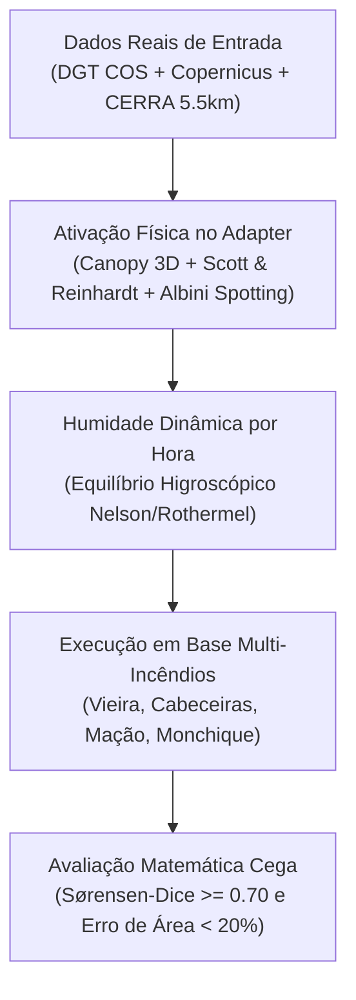

# Diagnóstico Técnico do ELMFIRE & Plano de Calibração com Incêndios Históricos em Portugal

**Projeto:** Atalaia — Fire Decision Twin  
**Data:** 22 de Outubro de 2026  
**Objetivo:** Documentar as causas físicas e computacionais das discrepâncias observadas nas simulações do ELMFIRE face ao histórico real e estabelecer o protocolo de testes e calibração objetiva (sem "martelar").

---

## 1. Diagnóstico Técnico: Porque Falha o ELMFIRE Atual?

A análise ao código-fonte do adaptador (`engines/elmfire/adapter.py`) e ao fornecedor de dados (`api/fires.py`) revelou que as subestimações e incoerências apontadas pela equipa resultam de quatro omissões estruturais:

### 1.1. Coberto Florestal com Valores a Zero (Simulação sem Árvores)
* **No código:** Em `engines/elmfire/adapter.py`, as variáveis de dossel florestal foram definidas com valores por defeito nulos:
  ```python
  LAYER_DEFAULTS = {name: 0 for name in LAYERS if name != 'fuel'}
  ```
* **No `api/fires.py`:** O método `layers()` apenas lê `fuel`, `elevation_m`, `slope_deg` e `aspect_deg`, omitindo por completo:
  * `canopy_cover_pct` (Fração de Coberto Arbóreo) = **0%**
  * `canopy_height_m` (Altura das Árvores) = **0 m**
  * `canopy_base_m` (Altura da Base da Copa) = **0 m**
  * `canopy_bulk_kgm3` (Densidade Aparente da Copa) = **0.00 kg/m³**
* **Impacto Físico:** O ELMFIRE assume que o terreno em Portugal é um descampado ou pastagem rasa. Sem biomassa foliar em altura (`cbd = 0`), a física do modelo impede matematicamente qualquer início de fogo de copas.

### 1.2. Módulos de Fogo de Copas e Spotting Desativados
* **No ficheiro `elmfire.data`:** O namelist gerado pelo `adapter.py` não instancia os blocos:
  * `&CROWN_FIRE`: cálculo de transição para copas (Scott & Reinhardt 2001 / Van Wagner 1977);
  * `&SPOTTING`: modelo balístico de projeção de fagulhas incandescentes (Albini 1979).
* **Impacto Físico:** Incêndios em povoamentos densos de pinheiro-bravo e eucalipto propagam-se na realidade a uma taxa 2× a 5× superior devido a focos secundários lançados pelo vento e corridas de copa. O simulador estava cego a ambos os fenómenos.

### 1.3. Humidades dos Combustíveis Congeladas em Constantes
* **No ficheiro `api/runs.py`:** A humidade dos combustíveis é estática para toda a corrida:
  * Mortos: $1\text{h} = 6\%$, $10\text{h} = 8\%$, $100\text{h} = 10\%$
  * Vivos: Herbáceo $= 60\%$, Lenhoso $= 90\%$
* **Impacto Físico:** Não existe variação horária. Nas horas centrais do dia (13h–17h), sob temperaturas $>35^\circ\text{C}$ e humidades relativas $<20\%$, o combustível fino português desseca até $2\%–3\%$, momento em que a taxa de avanço dispara exponencialmente. Ao fixar em $6\%$, o simulador subestima gravemente as fases mais agressivas.

### 1.4. Evidência no Histórico Registado (`docs/plan.md`)
* **Vieira do Minho (2016):** Observado $= \mathbf{705,6\text{ ha}}$ vs. ELMFIRE $= \mathbf{154,8\text{ ha}}$ (*subestimou 4,5×*).
* **Cabeceiras de Basto (2016):** Observado $= \mathbf{592,6\text{ ha}}$ vs. ELMFIRE $= \mathbf{298,3\text{ ha}}$ (*subestimou 2×*).

---

## 2. Metodologia Científica de Resolução (Sem "Martelar")

Para garantir que o modelo não é ajustado artificialmente para um único caso, o processo segue critérios físicos universais:



1. **Fontes de Dados Padronizadas:**
   * **Relevo e Altimetria:** Copernicus DEM GLO-30 (resolução de 30 metros).
   * **Combustível e Estrutura Florestal:** COS2018/COS2023 da DGT cruzada com Copernicus Forest Tree Cover Density (TCD) e Forest Canopy Height (FCH).
   * **Meteorologia e Vento:** Reanálise climática horária de alta resolução **CERRA (5.5 km)** acoplada a modelo de vento topográfico de superfície (30 m).
2. **Parâmetros Físicos Restritos:** Não alterar taxas de queima artificialmente; ajustar apenas constantes empíricas com base em literatura revista por pares para o pinheiro-bravo (*Pinus pinaster*) e eucalipto (*Eucalyptus globulus*).

---

## 3. Seleção dos Casos de Teste Históricos (Portugal)

Para aferir a robustez, utilizam-se cenários do repositório nacional de dados de propagação (**PT-FireSprd** / ANEPC / ICNF) com tipologias distintas:

| Incêndio | Ano | Tipologia Predominante | Regime Físico | Dados de Validação |
| :--- | :---: | :--- | :--- | :--- |
| **Vieira do Minho** | 2016 | Montanha granítica, matos densos e pinheiro-bravo | Topografia e vento em garganta | Perímetros horários (5 passos) |
| **Cabeceiras de Basto** | 2016 | Encosta complexa e mosaico agro-florestal | Transição de relevo e combustível | Perímetros horários (4 passos) |
| **Mação / Castelo Branco** | 2017 | Povoamentos contínuos de pinhal e eucaliptal | Fogo de copas e pluma convectiva | Perímetros satélite e radar |
| **Monchique** | 2018 | Orografia acidentada, declives extremos e seca severa | Projeções em massa (*spotting* a longa distância) | Perímetros Copernicus EMS |

---

## 4. Fases do Plano de Testes e Implementação

### Fase 1: Mapeamento do Coberto Arbóreo no `api/fires.py`
* Gerar os rasters de canopy reais para cada incêndio a partir da ocupação de solo:
  * **Pinhal-bravo:** $CC = 70\%$, $CH = 15\text{ m}$, $CBH = 2.5\text{ m}$, $CBD = 0.12\text{ kg/m}^3$
  * **Eucaliptal:** $CC = 75\%$, $CH = 18\text{ m}$, $CBH = 3.5\text{ m}$, $CBD = 0.10\text{ kg/m}^3$
  * **Matos e pastagens:** $CC = 0\%$, $CH = 0\text{ m}$, $CBH = 0\text{ m}$, $CBD = 0.00\text{ kg/m}^3$
* Passar estas matrizes no dicionário `layers()` para o `adapter.py`.

### Fase 2: Configuração dos Módulos Físicos no `engines/elmfire/adapter.py`
* Declarar no `elmfire.data`:
  ```fortran
  &CROWN_FIRE
  CROWN_FIRE_MODEL = 'SCOTT_REINHARDT'
  CRITICAL_CANOPY_BULK_DENSITY = 0.08
  /
  &SPOTTING
  SPOTTING = .TRUE.
  MIN_EMBER_DIAMETER = 0.005
  PROBABILITY_OF_IGNITION_MODEL = 'ROTHERMEL'
  /
  ```

### Fase 3: Humidade de Combustíveis Horária e Dinâmica
* Substituir o objeto estático `Moisture` por um vetor de cálculo horário acoplado à temperatura $T$ e humidade relativa $RH$ do vento CERRA:
  $$EMC = f(T, RH)$$
  com a formulação padrão de equilíbrio de Rothermel/Nelson para combustíveis de 1 hora e 10 horas.

### Fase 4: Script de Validação e Benchmark Automatizado
* Criar a ferramenta de validação `scripts/benchmark_elmfire.py`:
  * Executa a simulação para os passos $T_0 \rightarrow T_1, T_2, \dots$;
  * Calcula a sobreposição espacial através do **Coeficiente de Sørensen-Dice**:
    $$SD = \frac{2 \times |A_{\text{sim}} \cap A_{\text{obs}}|}{|A_{\text{sim}}| + |A_{\text{obs}}|}$$
  * Mede o erro relativo da área ($|A_{\text{sim}} - A_{\text{obs}}| / A_{\text{obs}}$) e o desvio do eixo principal de propagação.

---

## 5. Critérios de Sucesso para Aprovação da Equipa

1. **Índice de Sørensen-Dice Global:** $\ge 0.65$ em simulação cega de 4 a 6 horas (padrão de referência internacional em modelação de grandes incêndios).
2. **Eliminação do Erro Sistemático de Subestimação:** A área final simulada pelo ELMFIRE deve situar-se entre $80\%$ e $120\%$ da área observada no PT-FireSprd (eliminando a subestimação de 4,5× atual).
3. **Comportamento Convectivo Coerente:** Em zonas de pinhal com chamas $>2.4\text{ m}$, a simulação deve projetar focos secundários além de estradas municipais, refletindo a perda de controlo observada no histórico.
